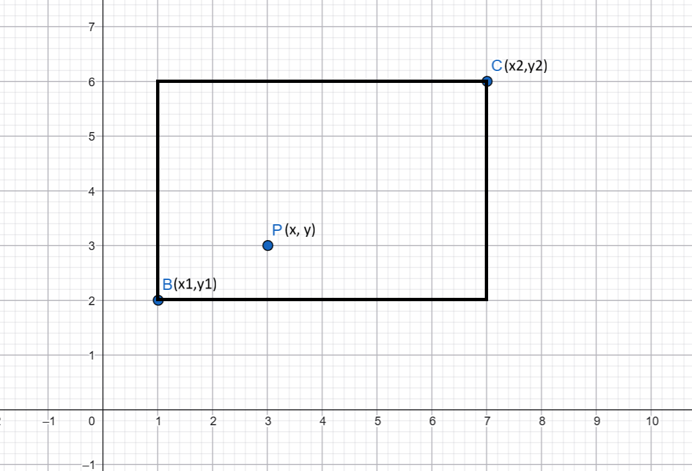

# Задачи


**Задача 1**

Напишете програма, която да проверява дали едно число е четно и отпечатва в конзолата "Even" (за четно) или "Odd" (за нечетно).

Вход:
```
4
```
Изход:
```
Even
```


**Задача 2**
Напишете програма, която по въведено число в интервала [1, 7] да изкара съответния ден от седмицата на екрана.


**Задача 3**

Напишете програма, която по подадена година определя и отпечатва на конзолата дали е високосна.

Вход:
```
2024
```
Изход:
```
Leap year!
```
---

Вход:
```
1900
```
Изход:
```
Not a leap year!
```

**Задача 4**

Напишете програма, която по подадена буква определя и отпечатва дали е главна или малка.

Вход:
```
f
```

Изход:
```
Lowercase
```
---

Вход:
```
P
```

Изход:
```
Uppercase
```


**Задача 5**  !!

Напишете програма, която по подадени координати на точка (x, y) и радиус r на окръжност проверява дали точката лежи в окръжността, върху нея или извън нея, и отпечатва на конзолата резултата от проверката. Окръжността приемаме, че е с център (0, 0).

Вход: (x y r)
```
1 2 4 
```

Изход
```
Inside
```
---

Вход:
```
3 4 5
```

Изход
```
On the border
```
---

Вход:
```
6 7 2
```

Изход
```
Outside
```
**Задача 6**
Напишете програма, в която се въвежда положително цяло число N и N знака подред. След това трябва да изкарате на екрана броя на малките букви, броя на големите букви, броя на цифрите и броя на знаците.


**Задача 7**

Напишете програма калкулатор, която по подаден символ за аритметичен оператор (+, -, *, /) и два операнда да пресмята съответния израз. 

Вход:
```
* 2 4
```

Изход:
```
8
```

**Бонус: Решете я със switch-case :)** 

**Задача 8 ЗА БОНУС**  
Дадени са 4 цели числа A, B, C и D. Да се намери сумата на двата края на сечението на [A, B] и [C, D].  
(−1018 <= 𝐴 <= 𝐵  𝐶 <= 𝐷 <= 1018)

~~~
#Примери

Вход  
2 8  
-7 5  
Изход  
7 --> [2,8] ^ [-7,5] = [2,5] 
Вход  
0 18  
22 22  
Изход  
0
Вход  
1 8  
2 7
Изход  
9 --> [2,7]
~~~

**Задача 9**

Напишете програма, която по подадени координати на точка P (x, y) и координати на точките B (x1, y1) и C (x2, y2) определя дали точката P лежи във, върху или извън страните на правоъгълника определен от точките B и C.

<details>
<summary>Hint</summary>

</details> 
